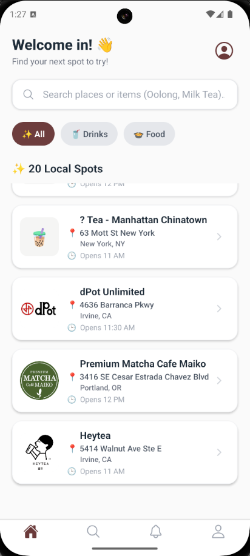
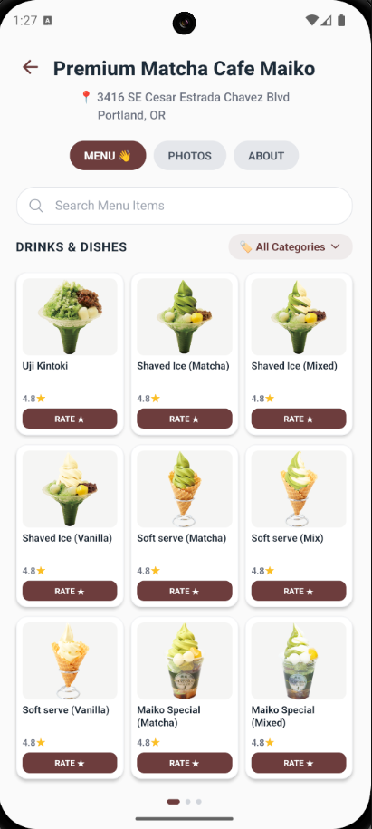

# BuhEats 🥩🧋

A comprehensive restaurant rating and social discovery app built with modern full-stack development practices.

## 🎯 Concept

The idea came from Yelp's/Beli's limitation - you can only rate entire restaurants, not individual menu items. A single bad dish shouldn't define an entire restaurant's reputation.

**FoodRater solves this by allowing granular item-level ratings with social features.**

## 🚀 Tech Stack & CI/CD

### Modern Development Practices
- ✅ **GitHub Actions CI/CD** with 4 automated workflows
- ✅ **Automated testing** on every pull request
- ✅ **Code quality checks** (ESLint, TypeScript validation)
- ✅ **Automated deployments** to iOS/Android app stores
- ✅ **Branch protection** and code review automation
- ✅ **Repository maintenance automation** (stale issues, dependency monitoring)

### Core Technologies
- **Frontend**: React Native + Expo SDK ~53
- **Backend**: Convex (TypeScript reactive backend)
- **Navigation**: Expo Router (file-based routing)
- **Auth**: @convex-dev/auth with password provider
- **Database**: Convex real-time database
- **Storage**: Convex file storage

## 📱 Key Features

### User Features
- 🔍 **Restaurant Search** with real-time filtering
- ⭐ **Granular Item Ratings** with detailed criteria
- 👥 **Social Features** (follow, tweets, comments, likes)
- 📸 **Photo Reviews** with image uploads
- 🔔 **Smart Notifications** for all interactions
- 📍 **Restaurant Details** with menus and photos
- 👤 **User Profiles** with activity feeds
- 📑 **Bookmarks** for saving favorite content
- 🚩 **Report System** with moderation tools
- 💬 **Comment Threading** with nested replies

### Admin Features
- 🔒 **Content Moderation** with flag/review system
- 📊 **App Statistics** dashboard
- 👨‍💼 **Staff-only** operations and restrictions

## 🛠️ Development Setup

### Prerequisites
- Node.js 18+ and npm
- Expo CLI: `npm install -g expo-cli`
- Convex account at [convex.dev](https://convex.dev)
- iOS: Xcode 14+ (Mac only)
- Android: Android Studio + Android SDK

### Quick Start
```bash
# Clone the repository
git clone https://github.com/CHANG88S/FoodAppTS.git
cd FoodAppTS/foodraterts

# Install dependencies
npm install

# Set up environment variables
cp .env.example .env.local
# Edit .env.local with your Convex deployment URL

# Start development server
npm start
```

### Available Scripts
- `npm start` - Start development server
- `npm run android` - Run on Android
- `npm run ios` - Run on iOS simulator
- `npm run web` - Run in web browser
- `npm run lint` - Run ESLint

## 🎨 Screenshots


 &nbsp;&nbsp;&nbsp;&nbsp; 
